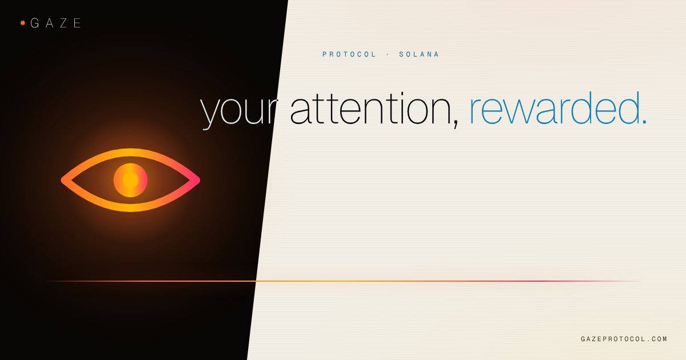

<!-- gz-context: docs -->
<picture>
  <source media="(prefers-color-scheme: dark)" srcset="social/og-default.png">
  
</picture>

# Gaze brand kit

Logos, colors, type and social art for anyone writing about, partnering with or building on Gaze.
Please read [USAGE](USAGE.md) before you use the mark, and [TRADEMARK](TRADEMARK.md) before you use the name.

## What's here

| Folder | Holds |
| --- | --- |
| [`logo/svg`](logo/svg) | Every mark and lockup as vector files. Use these whenever you can. |
| [`logo/png`](logo/png) | The common pieces as PNG, for tools that cannot take SVG. |
| [`social`](social) | Ready-made cards for link previews, X and square posts. |
| [`fonts`](fonts) | Geist and Geist Mono, under the SIL Open Font License. |
| [`tokens`](tokens) | Colors and type as CSS variables and a Tailwind config. |
| [`BOILERPLATE.md`](BOILERPLATE.md) | Approved ways to describe Gaze, in three lengths. |

## The logo in one minute

| Need | Use |
| --- | --- |
| Most places: nav, partner pages, decks | Eye + wordmark: `gaze-lockup-eye-dark.svg` on dark, `gaze-lockup-eye-light.svg` on light |
| A cover or poster, once and big | Eye over wordmark: `gaze-lockup-stacked-dark.svg` / `-light.svg` |
| An icon or avatar | The eye alone: `gaze-mark-on-obsidian.svg` |
| Footers and small print | Dot + wordmark: `gaze-lockup-dot-dark.svg` / `-light.svg` |

The full-color eye goes on dark backgrounds only. On light backgrounds use the mono ink eye.

## Colors

| Name | Hex | Role |
| --- | --- | --- |
| Obsidian | `#080604` | Background |
| Warm-white | `#f3efe6` | Light background |
| Bone | `#f5f4f0` | Text on dark |
| Ink | `#181410` | Text on light |
| Blaze | `#ff6b2c` | The accent and every action |
| Molten | `#ffb800` | Highlights |
| Pulse | `#ff3366` | Hot moments |
| Afterimage | `#0c84ba` | Settled and verified things; accents on warm-white |

The heat gradient runs blaze → molten → pulse. Use it for the eye, lines and decoration, never behind text.
Never blend orange into blue.

## Type

**Geist** at weight 100 for anything big. **Geist Mono**, uppercase and widely tracked, for small labels.
Headlines stay lowercase and calm, with one accent word: `your attention, rewarded.`

## Voice

Calm, exact and human. Say protocol, watcher, creator and creator token.
No hype, no urgency, no exclamation marks, and no talk of prices.

## Questions

Email **admin@graviton.xyz** for anything not covered here, including co-branding and press.

Gaze and the Gaze mark are trademarks of Graviton Inc. See [TRADEMARK](TRADEMARK.md).
